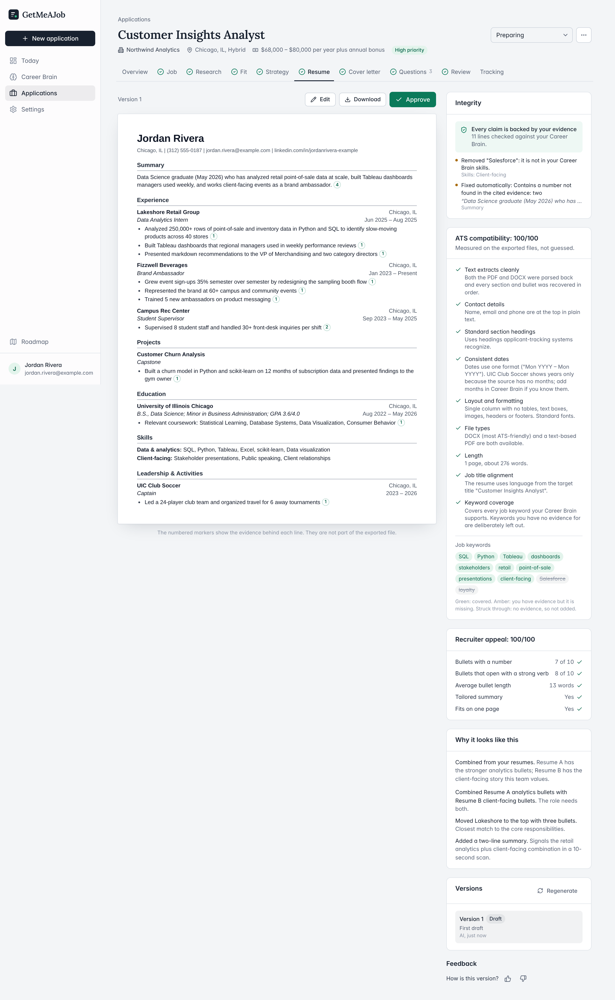
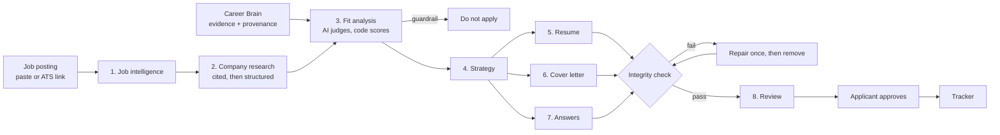
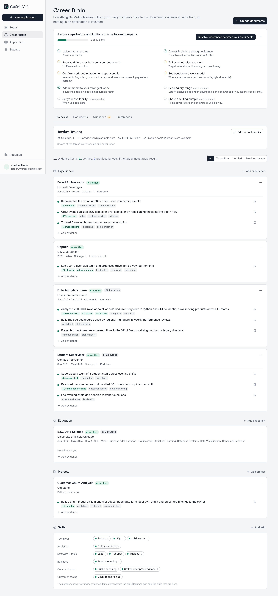
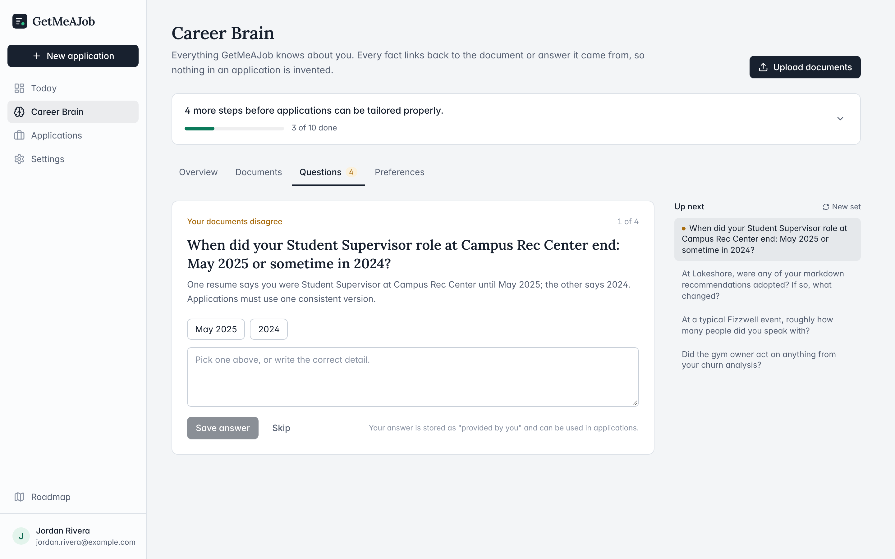
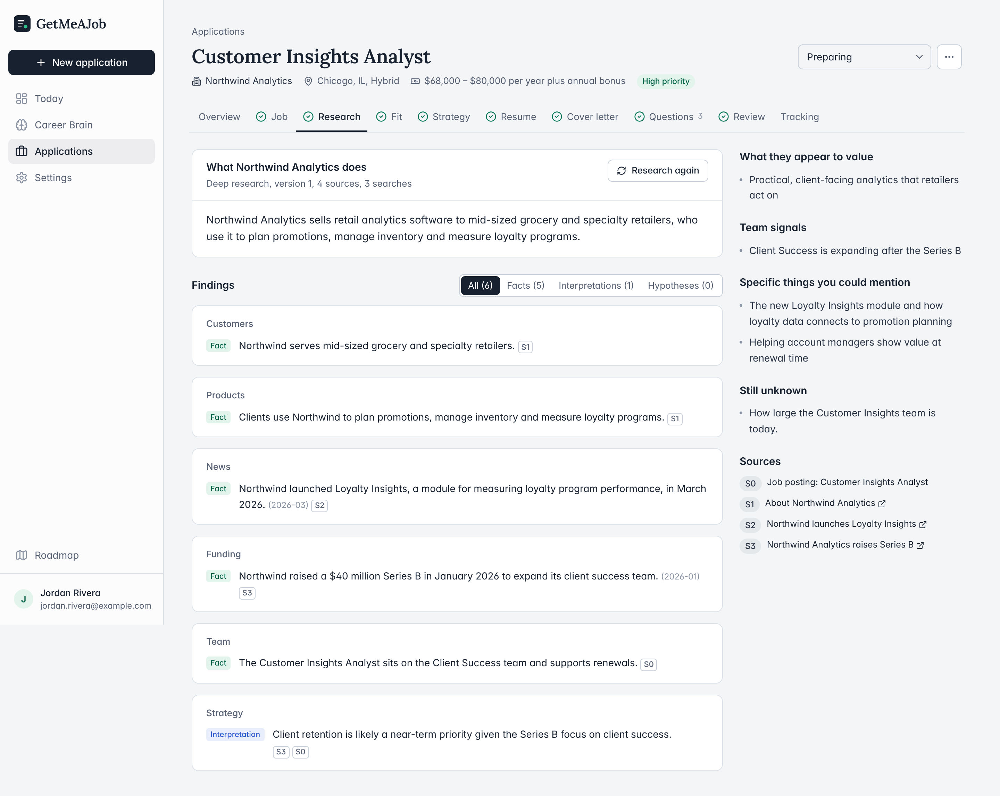
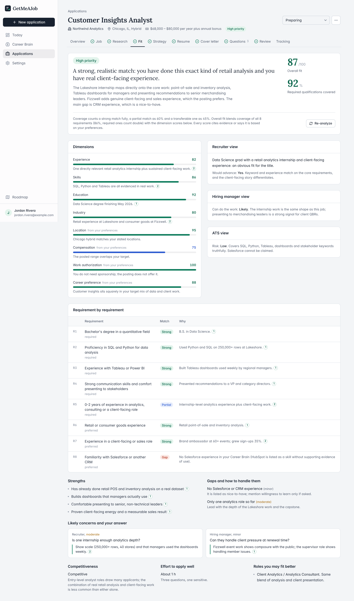
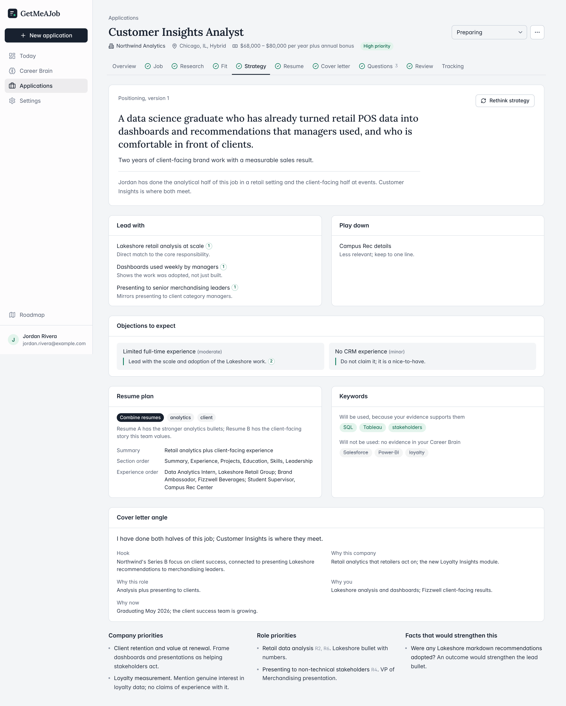
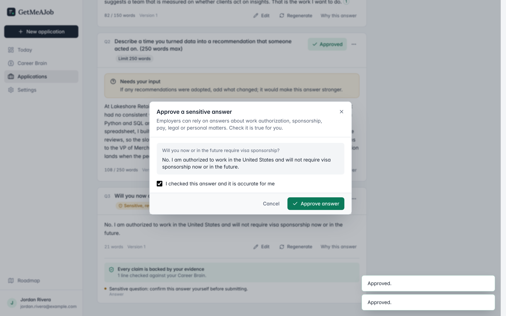
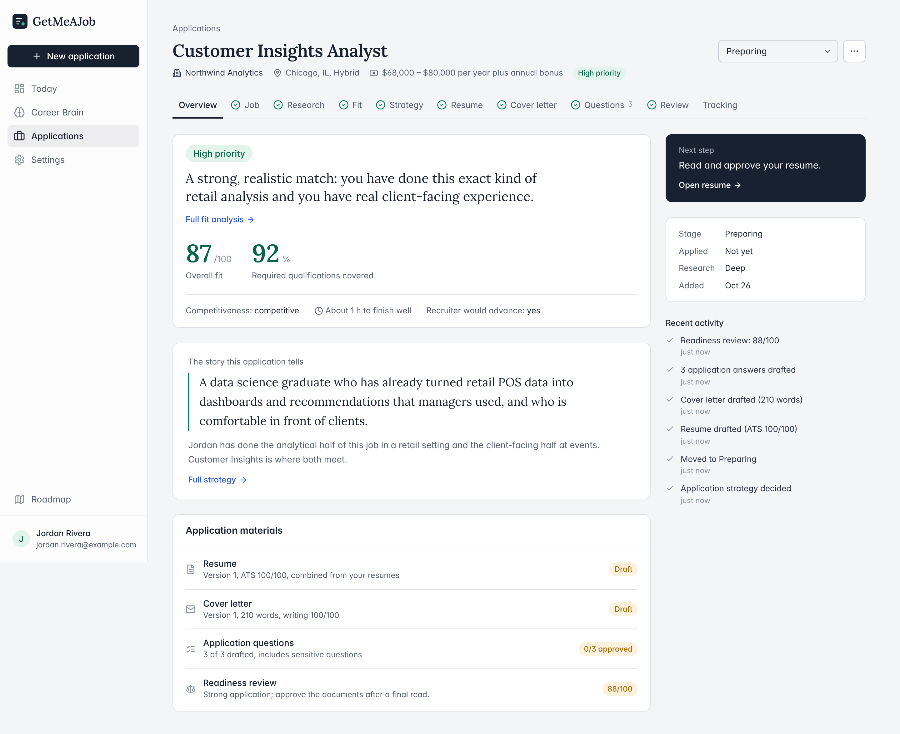
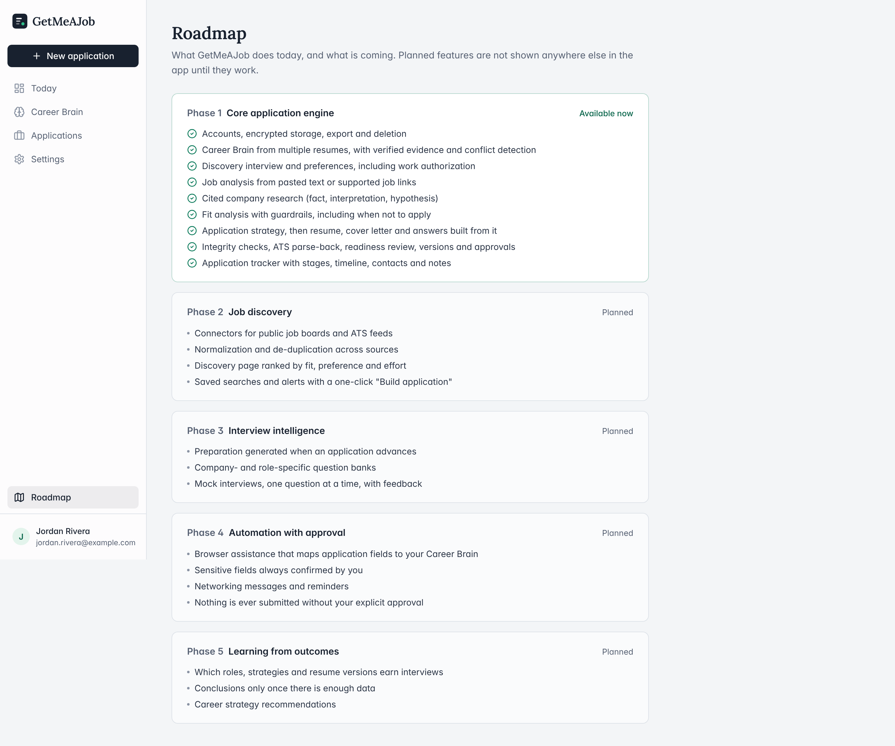

# GetMeAJob

**An AI job-application engine that won't make things up.**

GetMeAJob turns an applicant's resumes into an evidence-backed profile, studies each job and employer, says honestly whether the role is worth applying for, and only then drafts a tailored resume, cover letter and application answers. Every claim in those documents must trace back to something the applicant actually did. The applicant approves everything; the app never submits anything on their behalf.

> **Status:** working Phase 1 prototype, in development. It runs locally on one computer for one user. It is not a hosted product and has no external users.
>
> **Who built what:** I (Aaron Lysaght Walsh) designed the product, wrote the requirements and set the rules it must follow. **Claude, Anthropic's AI model, designed the software architecture and wrote the code, tests and technical documentation.** See [My role and Claude's role](#my-role-and-claudes-role).



*All screenshots show a fictional applicant ("Jordan Rivera") and a fictional employer ("Northwind Analytics"). The AI-generated content in them is pre-written test output, not real AI output.*

---

## Contents

- [The problem](#the-problem)
- [How it works](#how-it-works)
- [Features](#features)
- [Screenshots](#screenshots)
- [Architecture](#architecture)
- [My role and Claude's role](#my-role-and-claudes-role)
- [Development process](#development-process)
- [Testing and verification](#testing-and-verification)
- [Setup](#setup)
- [Limitations](#limitations)
- [Roadmap](#roadmap)
- [Privacy and security review](#privacy-and-security-review)
- [Licence](#licence)

---

## The problem

A serious job application needs job analysis, company research, a tailored resume, a cover letter and answers to screening questions. Generic AI tools speed this up but produce generic, sometimes false, material: invented metrics, skills the applicant doesn't have, inflated titles. Applicants also keep several resumes that describe the same experience differently, and spend time on roles that were never a good fit.

GetMeAJob was designed to produce the strongest *truthful* application possible, and to say "don't apply" when that is the honest answer.

## How it works



Four principles shape the design:

1. **Strategy before documents.** The resume, cover letter and answers are written from a stored application strategy, not straight from the job description.
2. **Evidence over prose.** Every fact in the profile keeps the verbatim quote and the document it came from. Prompts refer to evidence by short IDs, and code checks the output against them.
3. **Deterministic where possible.** Names, titles, employers, dates, scores and ATS checks are computed in code. The model chooses and phrases; code assembles, checks and renders.
4. **The applicant approves.** Everything is a draft until approved, and submission is recorded by the applicant, never performed by the app.

## Features

| Area | What it does |
| --- | --- |
| **Career Brain** | Parses PDF, DOCX, TXT and images. Merges several resumes into one set of roles, education, projects, skills and evidence. Each fact is labelled *verified*, *provided by you*, *inferred* or *unsupported*; only the first two can appear in an application. Contradictions between documents become questions. |
| **Discovery questions** | One question at a time, highest value first. Answers become evidence marked "provided by you". |
| **Preferences and readiness** | Target roles, locations, work model, work authorisation and sponsorship, salary, timing, writing voice. A checklist shows what is still needed before applications can be tailored well. |
| **Job intelligence** | Numbered requirements, responsibilities, keywords, likely screening criteria and sponsorship stance, from a pasted posting or a Greenhouse, Lever, Ashby or SmartRecruiters link. |
| **Company research** | Web research with citations, then a separate step that labels each finding *fact*, *interpretation* or *hypothesis* and links it to sources. |
| **Fit analysis** | Requirement-by-requirement matching with cited evidence, dimension scores, and separate recruiter, hiring-manager and ATS views. Guardrails (for example, sponsorship needed but not offered) stop the build with "do not apply". |
| **Application strategy** | Positioning, what to lead with and play down, objections to expect, which resume to base on, and which keywords can and cannot honestly be claimed. |
| **Resume, cover letter, answers** | Built from the strategy. Exported as DOCX and PDF; the ATS score comes from parsing the exported files back. Answers respect word limits; sensitive answers (authorisation, salary) need explicit confirmation. |
| **Integrity engine** | Generated *and* user-edited text is checked for numbers and tools that don't appear in the cited evidence. Failures get one repair attempt, then the line is removed and reported. Approval is blocked while problems remain. |
| **Review and versions** | Readiness score, strengths, weaknesses and suggested edits. Accepting an edit creates a new version; nothing is overwritten. |
| **Tracker** | Board and table views, hiring stages, timeline, contacts, notes and follow-up reminders. |
| **AI providers** | Anthropic (default), OpenAI, or any OpenAI-compatible endpoint, with a model per role. Every AI call is logged with tokens and estimated cost. |
| **Privacy** | Encrypted documents and API keys, per-user data isolation, activity log, full ZIP export and account deletion. |

## Screenshots

Fictional applicant, simulated AI output.

| | |
|---|---|
|  **Career Brain**: every fact is labelled with its provenance; the same internship found in two resumes shows "2 sources". |  **Conflict question**: two resumes disagree on a date, so the app asks instead of guessing. |
|  **Company research**: findings labelled Fact or Interpretation, each with sources. |  **Fit analysis**: recruiter, hiring-manager and ATS views and a requirement-by-requirement table. |
|  **Strategy**: positioning, what to lead with, objections, and keywords that can't honestly be claimed. |  **Sensitive answers** need explicit confirmation before approval. |
|  **Application overview** with fit score and materials. |  **Roadmap**: Phase 1 available, Phases 2–5 planned. |

## Architecture

One Node.js process serves a React single-page app and a JSON API, stores everything in SQLite on the user's machine, and calls an AI provider only for steps that need judgement.

| Layer | Technology |
|---|---|
| Runtime and language | Node.js ≥ 22.13, TypeScript 6 |
| Frontend | React 19, Tailwind CSS 4, Headless UI, Floating UI |
| Backend | Node.js HTTP server with its own router, cookie handling and Content-Security-Policy |
| Database | SQLite through Node's built-in `node:sqlite`, with migrations |
| Validation | Zod 4; schemas shared by server, client and AI prompts |
| Documents | docx, pdf-lib, pdfjs-dist, JSZip |
| Build and tests | esbuild, `node:test`, Playwright |

```
src/
  shared/    constants, text utilities (number extraction, quote matching), Zod schemas
  server/
    ai/        provider layer: anthropic, openai, scripted (tests), prompts, registry, service
    db/        SQLite and migrations
    http/      server adapter, router, cookies
    repos/     user-scoped data access
    routes/    auth, brain, applications, dashboard, settings, tasks
    security/  passwords, sessions, encryption, rate limits, audit log
    services/  brain, documents (parse, render, ATS), integrity, jobs, pipeline
    tasks/     durable background queue in SQLite
  client/
    pages/     Dashboard, Career Brain, Applications, Settings, Roadmap
tests/       unit, integration, e2e, fixtures (fictional applicant + scripted AI)
```

More detail, including the data model and security design: [docs/ARCHITECTURE.md](docs/ARCHITECTURE.md).

## My role and Claude's role

**I defined what the product is and the rules it must obey. Claude decided how to build it and built it.** I conceived GetMeAJob, defined its 34 areas of product requirements, designed its core workflows and evidence-integrity rules, and directed development and testing using Claude. Claude generated the application code, architecture and automated tests. My contribution focused on product design, requirements engineering, validation and AI-assisted development.

| Area | Me (Aaron) | Claude |
|---|---|---|
| Vision and problem framing | Conceived the product as an AI career agent rather than a resume builder, framed around getting from qualified job to offer. | — |
| Requirements | Wrote the requirements document: 34 requirement areas, the minimum successful product and a five-phase plan. | — |
| Product rules | Set the integrity rule (never invent experience, skills, metrics, titles or dates) and the four provenance categories; human approval of everything; confirmation of sensitive answers; never submitting for the applicant; respecting site terms; keeping ATS optimisation separate from human appeal; telling the applicant when not to apply. | Turned these rules into enforceable mechanisms: evidence IDs, the validator, the approval gate, guardrails and deterministic rendering. |
| Architecture and stack | Set constraints: multi-user isolation, provider independence, security priorities. | Chose the stack; designed the architecture, data model, pipeline and security. |
| Prompts | Wrote the brief that directed the build. | Wrote the in-app prompts, JSON schemas, and the repair and writing-check logic. |
| Code and tests | — | Wrote all source code and the automated tests. |
| Real-world use | Ran it on my own job search (October 2026), which exposed an API limit described below. | — |
| Maintenance (26 Oct 2026) | Directed the stabilisation work and decided what to publish. | Fixed the test suite and a type error, replaced personal example text with fictional data, upgraded Zod, and prepared this repository and README. |
| Documentation | Requirements and brief. | Architecture document, change log and this README, reviewed by me. |

Three files were edited during my first live session on 7 October 2026. No record shows whether I or Claude made those edits, so they are not attributed to either.

## Development process

1. **Specification.** I wrote the product requirements and a standing brief for Claude: the objective, the integrity rule, scope and principles, with an instruction to make technical decisions itself and ask only when a decision needed my input.
2. **Build.** Claude designed and built Phase 1 against that brief, testing the whole pipeline with a scripted AI provider because no API key was available in its build environment.
3. **Real use.** On 7–8 October 2026 I ran the app with the Anthropic API on my own resumes: 8 resumes merged into one profile, 40 follow-up answers, and two real applications taken through research, fit, strategy, resume, cover letter and review. The app's own log records 70 successful AI calls (about $5 by its own estimate).
4. **What broke.** The Anthropic API rejected the largest output schemas with "The compiled grammar is too large". Five tasks were switched to describing the schema in the prompt instead, with the output still validated and retried. That workaround then broke the test suite, which relied on the schema being sent natively.
5. **Stabilisation (26 October 2026).** Claude fixed the test provider without changing live behaviour, added a regression test that fails if the workaround is removed, fixed a TypeScript error, replaced personal example text with fictional data, and upgraded Zod from 3.25 to 4.6. Details: [docs/CHANGES-2026-10-26.md](docs/CHANGES-2026-10-26.md).

## Testing and verification

Tests never call a real AI provider. `tests/fixtures/scripted.ts` returns fixed responses, including deliberately bad ones (an invented skill, an inflated number) to show that the integrity checks catch them.

| Check | Linux, after fixes (Zod 3.25) | Windows 11, after Zod 4 upgrade |
|---|---|---|
| `npm run typecheck` | 0 errors | 0 errors |
| `npm test` (unit + integration) | 23 of 23 pass | 23 of 23 pass |
| `npm run build` | OK | OK |
| `npm run test:e2e` (browser walkthrough) | Passes | Not run: Playwright not installed |
| Live Anthropic API | 70 successful calls on 7–8 Oct (before the upgrade) | **Not run after the upgrade** |

The tests cover CSRF protection, security headers and malformed URLs; sign-up; building the Career Brain from two resumes; resolving a conflict; preferences and readiness; the full pipeline from a pasted job; DOCX and PDF downloads; accepting a review suggestion; an invented number in a user edit blocking approval; the submission gate; the sponsorship "do not apply" guardrail; isolation between users; export and account deletion; the live-API schema workaround; and quote matching, number extraction and invented-metric detection.

**What has not been tested:** the quality of real AI output, and the live API with the upgraded Zod version.

## Setup

You need **Node.js 22.13 or newer**. AI features need an API key from [Anthropic](https://console.anthropic.com) (recommended), OpenAI, or an OpenAI-compatible provider; the tests do not.

```bash
npm install
npm run build
npm start
```

Open **http://localhost:3000**, then:

1. **Create an account.** The first account owns the installation; sign-ups close after that.
2. **Settings → AI provider:** paste your API key, save, and press *Test connection*. The key is stored encrypted.
3. **Career Brain → Upload documents:** add one or more resumes.
4. Answer the **Questions** and fill in **Preferences**, especially work authorisation.
5. **New application:** paste a job description or a supported link, add the application questions, and choose *Build application* or *Check fit first*.
6. Review and approve the documents, download them, apply on the employer's site yourself, then **Mark as submitted** and track it.

### Development

```bash
npm run dev        # rebuilds the client on change and restarts the server
npm test           # unit + integration tests, with scripted AI
npm run typecheck
npm run test:e2e   # browser walkthrough; first: npm i -D playwright && npx playwright install chromium
```

### Configuration

Optional. Copy `.env.example` to `.env`:

| Variable | Default | Purpose |
| --- | --- | --- |
| `PORT` / `HOST` | `3000` / `127.0.0.1` | Where the server listens. The default is reachable only from your own computer. |
| `DATA_DIR` | `./data` | Database, encrypted documents and the encryption key. |
| `ANTHROPIC_API_KEY`, `OPENAI_API_KEY`, `OPENAI_BASE_URL` | none | Optional server-wide keys. A key saved in Settings takes precedence. |
| `SIGNUP_MODE` | `first-user` | `first-user`, `open` or `closed`. |
| `APP_SECRET` | generated | 64 hex characters. Overrides `data/secret.key`. |
| `ALLOW_OUTBOUND_FETCH` | `true` | Set `false` to disable importing jobs from links. |

All data lives in `DATA_DIR`. Back up the whole folder, including `secret.key`: without it, encrypted files and keys can't be read. Documents are sent only to the AI provider you configure.

## Limitations

- **Prototype, not a product.** Single user, runs locally, not deployed. Running it publicly would need HTTPS, `SECURE_COOKIES=true` and closed sign-ups.
- **Output quality has not been evaluated.** The live runs show the pipeline works end to end, not that its documents are good.
- **No live AI test since the Zod 4 upgrade.** Automated tests pass; live behaviour after the upgrade is untested.
- **Tool checking uses a fixed list** of about 60 common tools and technologies; a tool not on the list could pass the automatic check. Numbers are checked generally.
- **OpenAI-compatible endpoints** have no web research.
- **No SaaS infrastructure yet:** no Postgres, object storage, separate worker, email verification, password reset, organisations or billing.
- **Sites that forbid automation** (LinkedIn, Indeed, Glassdoor) are not integrated; their postings must be pasted.

## Roadmap

Phase 1 (this repository) is the core application engine. Planned, not built:

- **Phase 2:** job discovery from public job boards and ATS feeds, ranked by fit.
- **Phase 3:** interview preparation and mock interviews.
- **Phase 4:** browser assistance for application forms, always with approval.
- **Phase 5:** learning from outcomes, drawing conclusions only with enough data.

## Privacy and security review

Before publication (26 October 2026), every file in this repository was checked:

- **No credentials:** no API keys, tokens, private keys, real passwords or `.env` file. The only passwords are obvious test values in the integration tests.
- **No personal data:** no real resumes, Career Brain content, database, uploaded documents or encryption keys. Example text that came from a real resume was replaced with fictional data. The only names and contact details belong to the fictional persona (`example.com` addresses, a 555 phone number).
- **Not included:** the `data/` folder, logs, backups, private notes, `node_modules/` and build output (`dist/`).
- **No paths from the author's computer.** All dependencies come from the public npm registry.
- **Screenshots** show only the fictional applicant and simulated AI output.

Built-in security measures: scrypt password hashing; session tokens stored only as hashes; httpOnly, SameSite=Lax cookies; a CSRF header check; AES-256-GCM encryption at rest; a strict Content-Security-Policy with no third-party scripts; rate limits on sign-in, sign-up and AI endpoints; SSRF protection on job-link import; and listening on 127.0.0.1 by default.

## Licence

No licence has been chosen yet, so all rights are reserved. The bundled Inter and Lora fonts are under the SIL Open Font License ([public/fonts/LICENSE.txt](public/fonts/LICENSE.txt)).
